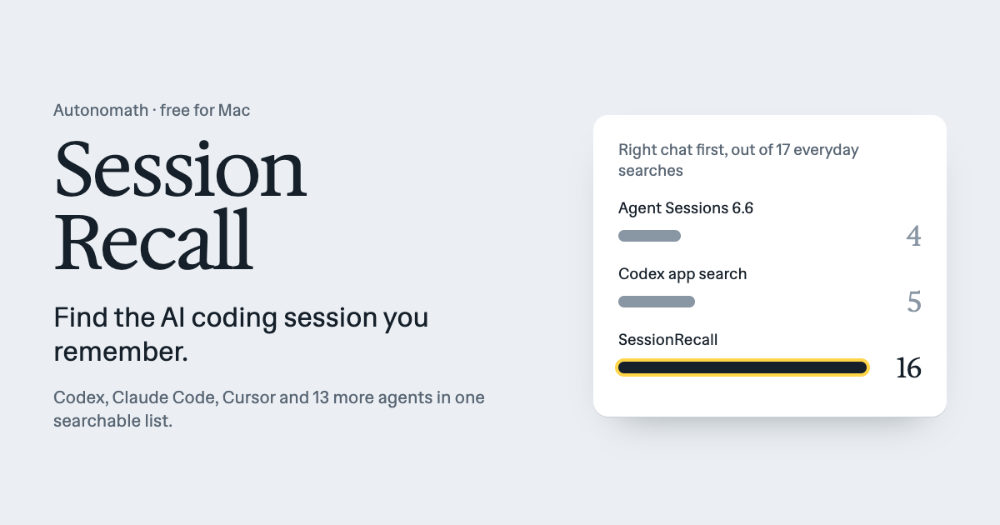
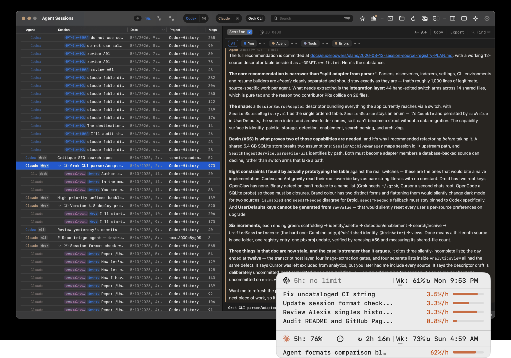
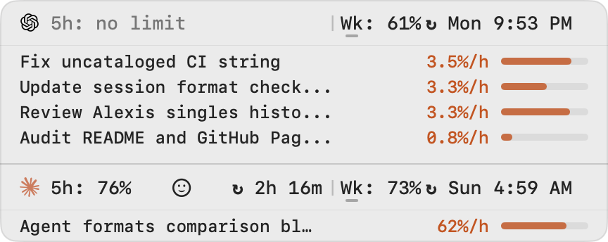

<p align="center">
  
</p>

<h1 align="center">SessionRecall</h1>

<p align="center"><b>Find the AI coding session you remember.</b><br>A free Mac app for everything your coding agents have done, with a search that puts the chat you meant first.</p>

<p align="center">
  <a href="https://github.com/autonomath/SessionRecall/releases/latest"><b>Download SessionRecall 1.1.1</b></a>
  ·
  <a href="https://autonomath.github.io/SessionRecall/">Website</a>
  ·
  <a href="https://github.com/autonomath/SessionRecall/releases">All releases</a>
</p>

<p align="center"><sub>Free and open source · macOS 14 or later · Apple silicon and Intel · signed and notarized</sub></p>

Your coding agents keep a record of everything: every prompt you typed, every answer, every command they ran and what it printed. Codex, Claude Code, Cursor and 13 other coding agents save those sessions as files on your Mac, each in its own folder and format. SessionRecall reads them where they are and puts them in one list you can browse, search, read and resume.

It is built on [Agent Sessions](https://github.com/jazzyalex/agent-sessions) by Alexander Malakhov and keeps everything that app does. What it changes is search. You type the few words you remember, and the chat you meant comes first, with the passage that matched.

## The problem it solves

Two weeks ago an agent fixed a crash for you, set up a tunnel, or explained an error. You remember roughly what it was about, not the exact words. That is where most session search falls short:

- **It wants the exact phrase.** A search for "merge drone videos ffmpeg" finds nothing if the chat said "join these drone clips with ffmpeg".
- **It lists matches newest first.** A common word buries the chat you want under dozens of newer ones.
- **It skips tool output.** Errors, logs and file contents often hold the one word you remember, and many tools never look there.

SessionRecall indexes every part of every session and ranks the results, so a rough description is enough.

## How it compares

17 everyday searches, each aimed at one real chat on a Mac with about 6,300 agent sessions, typed into each app:

| | Agent Sessions 6.6 | Codex app search | SessionRecall |
|---|---:|---:|---:|
| Right chat first | 4 | 5 | **16** |
| Right chat in the top three | 5 | 5 | **17** |
| Found at all | 8 | 5 | **17** |
| No results at all | 9 | 2 | **0** |

On 28 harder searches from the same Mac, typed from memory to find chats that had gone missing, the right chat came first once in Agent Sessions 6.6, twice in the Codex app and 15 times in SessionRecall. The [website](https://autonomath.github.io/SessionRecall/) lists every search, explains how each app was measured, and shows where each one falls short.

These figures were measured against Agent Sessions 6.6. Agent Sessions 7.0, released on 23 November, looks for every word you type instead of the exact phrase, so it finds far more, but it still lists matches newest first and shows no passage. That night the same searches ran through 7.0 and SessionRecall 1.1 on one copy of the index, leaving out the chats that quote the searches: 7.0 put the right chat first in 1 of the 17 everyday searches and 6 of the 28 harder ones, SessionRecall in 16 and 20. Those are the results 7.0 shows as you type. Pressing Return makes it read every session file, which can add matches, still newest first.

## What makes the search different

- **Every part of a chat is indexed.** Titles, your prompts, the agent's replies, tool calls and tool output each get their own full-text index, with the whole text rather than a sample.
- **Your words don't have to match exactly.** The exact phrase ranks highest, but any one of the words can match. The last word also matches longer words, so results appear while you type, and accents are ignored: "cafe" finds "café".
- **A chat where your words sit together ranks higher.** Prompts and replies are also indexed as passages of about 1,500 characters, and a chat's best passage adds to its score, so the chat that says it in one place beats a long one that mentions each word somewhere.
- **Results are ranked.** Each match is scored with BM25, the formula search engines use, so a rare word counts for more than a common one. Then it is weighted by where it was found: title ×4, your prompts ×3, replies ×2, tool calls ×1, tool output ×0.6.
- **One row per chat, with the reason.** A long chat that Codex stored as several files shows up as one result. Each row says which part matched and shows the passage around your words.
- **It opens on the match.** Clicking a result loads the chat, turns on tool output if that is where the word is, and scrolls to it.
- **Chats in progress are searchable.** A chat you are still working in is read from its file at search time, so new text shows up about 20 seconds after it is saved.
- **It tells you what it can't see yet.** Sessions that aren't indexed yet are counted at the bottom of the window instead of silently missing.

## Everything else it does

SessionRecall is based on Agent Sessions 7.0.1, including Economics in Analytics, syntax color in tool output and search inside the session-list pane. The screenshots below come from Agent Sessions, which looks the same.

<p align="center">
  
</p>

- **Every agent in one list.** Sessions from all supported agents sit side by side, with filters per agent and project.
- **See the whole chat at a glance.** The Session view draws the chat as marks, down the side or across the top: your prompts, the replies, tool runs, and dots where your search matched. Point at a mark to read it, click to go there.
- **Read the session.** Each turn shows your prompt and the agent's answer. Tool calls, failed ones included, sit behind the Tools chip, and Find searches all of it.
- **Pick up where you left off.** Copy a resume command, or open a supported CLI session in Terminal.app, iTerm2, Warp, Ghostty or Macterm. Claude Code sessions can open in VS Code.
- **See which session is burning your quota.** The Quota Meter shows live per-session Codex and Claude burn against the 5-hour and weekly limits, in the menu bar or beside the MacBook camera.
- **See what a session used.** Session Info shows the model, tokens, activity and an API-equivalent cost, when the agent records them.

<p align="center">
  
</p>

## Supported agents

| Agent | History it reads | Resume |
|---|---|---|
| Codex | Desktop, CLI, VS Code | Supported sessions |
| Claude Code | Claude Desktop, Claude Code CLI | Supported sessions |
| Cursor | Agents Window, CLI | Supported sessions |
| GitHub Copilot CLI | CLI | Supported sessions |
| OpenCode | Desktop, TUI | Supported sessions |
| Antigravity | Desktop, CLI | Supported sessions |
| Pi | CLI | Supported sessions |
| Kimi Code | CLI | Supported sessions |
| Grok CLI | CLI | Supported sessions |
| Hermes | CLI | Supported sessions |
| OpenClaw | CLI | Browse only |
| Qwen Code | CLI | Active sessions (end-to-end unverified) |
| Devin CLI | CLI | Supported active sessions |
| fx | CLI | Command tested (interactive reopen unverified) |
| Cline | Desktop, CLI | Browse only |
| DeepSeek Harness | CLI | Browse only |
| Droid | Legacy CLI sessions | Browse only |

Cline CLI and Cline Desktop support comes from Agent Sessions 5.4. DeepSeek Harness support is an independent integration, not an official partnership. Capabilities depend on what each agent records and on its installed version.

## Install

1. Download **SessionRecall-1.1.1.dmg** from the [latest release](https://github.com/autonomath/SessionRecall/releases/latest).
2. Open it and drag SessionRecall to Applications. The app is signed with a Developer ID and notarized by Apple.
3. Open SessionRecall. It finds your agents' session folders and builds its search index in the background. You can browse and search while it works.

Good to know:

- **Disk and memory.** On a Mac with about 6,300 sessions the index takes 1.11 GB, of which tool output is 604 MB; Settings can leave tool output out. The first indexing peaked at about 2.5 GB of memory.
- **Updates.** SessionRecall checks this repository's releases and installs signed updates through Sparkle.
- **Coming from Agent Sessions?** Quit it first. Both apps keep their index in ~/Library/Application Support/AgentSessions, so run one at a time. SessionRecall's settings start fresh.

## Privacy

- Your session history stays on your Mac. The index is a local SQLite database, and no session text is uploaded anywhere.
- There is no account and no telemetry.
- The app goes online to check this repository for updates, to fetch a public list of model prices for cost estimates, and for the optional Codex and Claude features (the Quota Meter and Claude cloud sessions), which talk to OpenAI and Anthropic with the sign-in those tools already keep.

## Build from source

```bash
git clone https://github.com/autonomath/SessionRecall.git
cd SessionRecall
xcodebuild -project AgentSessions.xcodeproj -scheme AgentSessions -configuration Release -destination 'platform=macOS' build
```

The Xcode project and target keep their Agent Sessions names, so the build is AgentSessions.app with SessionRecall's name and bundle id inside. The search code is in AgentSessions/Search and AgentSessions/Indexing/DB.swift, and its tests are in AgentSessionsTests/RankedSearchTests.swift.

## Credits and license

SessionRecall is a fork of [Agent Sessions](https://github.com/jazzyalex/agent-sessions) by Alexander Malakhov, released under the MIT license (see [LICENSE](LICENSE)). The session formats, transcript views, Quota Meter, Session Info and design all come from that project. SessionRecall changes the search, and its own name, updates and links. If you find it useful, consider [sponsoring Agent Sessions](https://github.com/sponsors/jazzyalex).

SessionRecall is made by [Autonomath](https://autonomath.github.io/), who makes small tools that make a Mac less annoying. Found a bug or have an idea? [Open an issue](https://github.com/autonomath/SessionRecall/issues).

